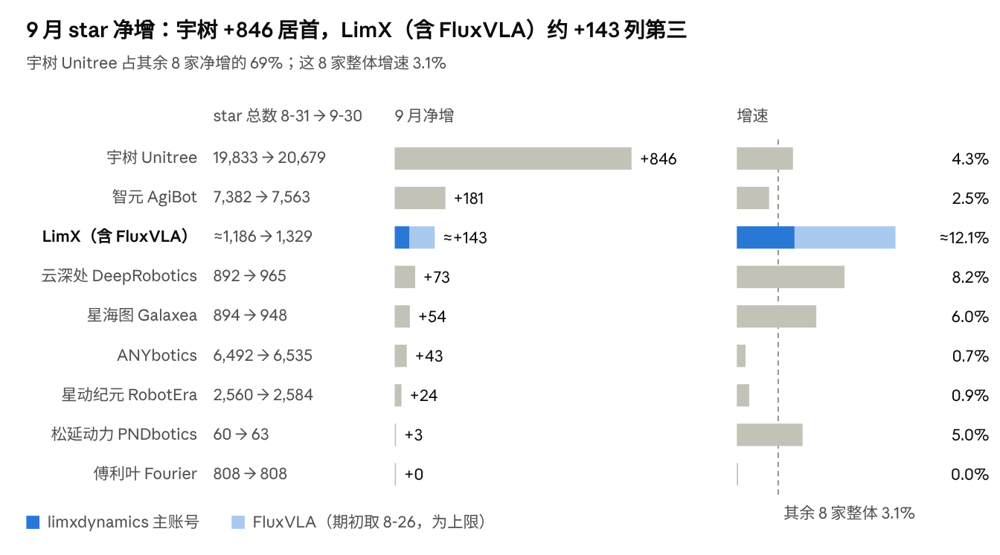

  

  <b>中文</b> | <a href="README_en.md">English</a>

  
  
  
  

# Embodied AI Insights

具身智能开源生态观察。基于 GitHub 公开数据，持续追踪机器人与具身智能领域的开源项目、社区动态与行业趋势。

由 [LimX Dynamics](https://github.com/limxdynamics) 开源团队维护。

## 最新一期：2026 年 9 月

[阅读全文 →](monthly-report/2026-09/README.md)

| 数字 | 含义 |
| --- | --- |
| **+1,224** | 除 LimX 外 8 家企业 9 月 star 合计净增（38,921 → 40,145，增速 3.1%） |
| **69%** | 宇树一家占这 8 家合计增量的比例 |
| **约一半** | 增长榜前 14 个仓库的增量中，基础模型 / VLA / 世界模型的占比 |
| **261 : 5** | 2 个随新品发布上线的新仓库 star vs 其余 9 个当月新建仓库的 star 合计 |

  

## 栏目

### 开源月报

每月统计主要具身智能企业在 GitHub 上的开源动态：star 与 fork 增长、社区活跃度、热门项目与新开源项目，并总结当月行业趋势。

| 期数 | 核心看点 |
| --- | --- |
| [2026 年 9 月](monthly-report/2026-09/README.md) | 基础模型成为开源增长主力；人形控制走向"动作数据 + 通用框架"；新仓库需配合宣发才能获得关注 |

### 专题文章

即将上线。

## 覆盖范围

目前追踪 9 家企业的 GitHub 组织：

| 企业 | GitHub |
| --- | --- |
| 宇树科技 Unitree | [unitreerobotics](https://github.com/unitreerobotics) |
| 智元机器人 AgiBot | [AgibotTech](https://github.com/AgibotTech) |
| 逐际动力 LimX Dynamics | [limxdynamics](https://github.com/limxdynamics)、[FluxVLA](https://github.com/FluxVLA) |
| 云深处 DeepRobotics | [DeepRoboticsLab](https://github.com/DeepRoboticsLab) |
| 星海图 Galaxea | [OpenGalaxea](https://github.com/OpenGalaxea) |
| ANYbotics | [ANYbotics](https://github.com/ANYbotics) |
| 星动纪元 RobotEra | [roboterax](https://github.com/roboterax) |
| 傅利叶 Fourier | [FFTAI](https://github.com/FFTAI) |
| 松延动力 PNDbotics | [pndbotics](https://github.com/pndbotics) |

覆盖范围会随行业发展调整，欢迎通过 issue 推荐值得追踪的组织或项目。

## 数据说明

- **来源**：全部数据来自 [GitHub REST API](https://docs.github.com/en/rest) 提供的公开信息，每日采集存档。
- **统计周期**：按北京时间自然月统计。
- **数据公开**：汇总数据（CSV）暂未上线，敬请期待。
- **局限**：star、fork 等指标反映的是关注度，不等于实际使用量；issue 与 PR 统计未区分企业内部与外部贡献者。各期具体口径见对应月报。
- **利益披露**：月报由被追踪企业之一 LimX 撰写。跨企业排名只采用所有企业都可获得的同口径公开数据，详见各期月报的"数据口径与披露"。

## 引用与许可

本仓库的文章与数据采用 [CC BY 4.0](https://creativecommons.org/licenses/by/4.0/deed.zh-hans) 许可，欢迎转载和引用，请注明出处：

> LimX Dynamics, Embodied AI Insights, https://github.com/limxdynamics/embodied-ai-insights

## 反馈

发现数据错误或有建议，欢迎提交 [issue](https://github.com/limxdynamics/embodied-ai-insights/issues)。
