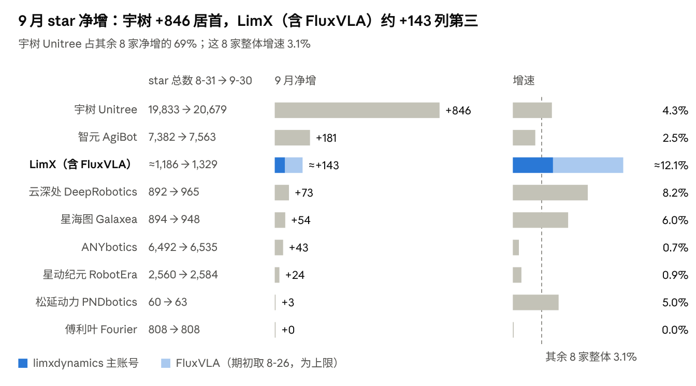
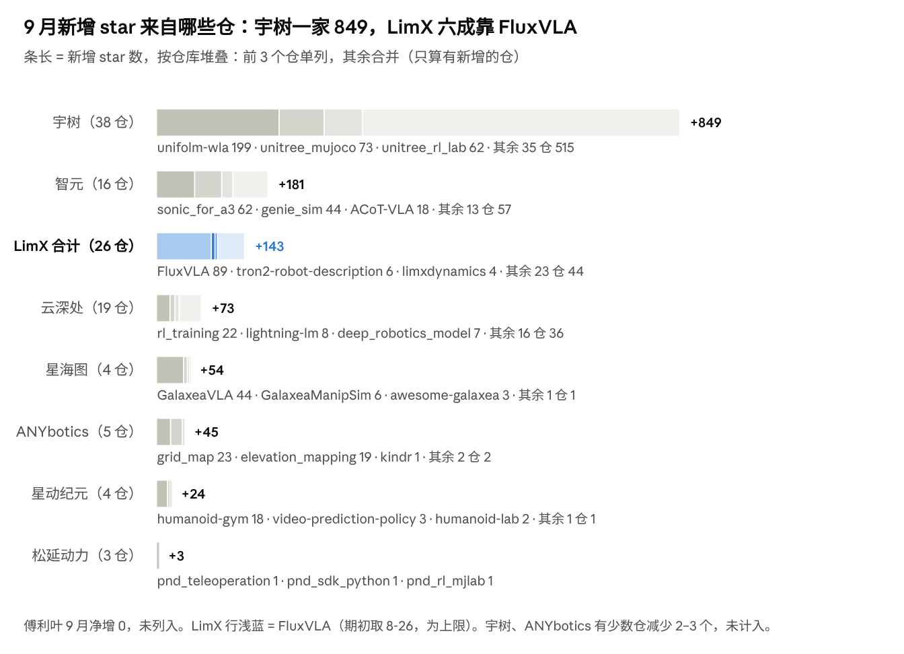

# 具身智能开源观察 · 2026 年 9 月

> **一句话速览**：开源重心从运动控制转向具身基础模型，头部集中度进一步加剧——宇树一家的 star 净增相当于其余 7 家之和的 2.2 倍。

本报告由 LimX 团队撰写，数据来自 GitHub 公开 API 每日采集存档。star 净增取 2026-08-31 与 09-30 两次快照之差；fork、issue、PR 按创建时间落在 9 月统计（北京时间）。完整口径与利益披露见[文末](#数据口径与披露)。

## 本月速览

| 数字 | 含义 |
| --- | --- |
| **+1,224** | 其余 8 家 9 月 star 合计净增（存量从 38,921 增至 40,145，整体增速 3.1%） |
| **69%** | 宇树一家占这 8 家合计增量的比例 |
| **约一半** | 增长榜前 14 的仓库中，基础模型 / VLA / 世界模型贡献的增量占比 |
| **261 : 5** | 2 个随新品发布上线的新仓 star vs 其余 9 个当月新建仓库的 star 合计 |
| **第 3 名** | LimX（含 FluxVLA）9 月 star 净增约 +143，排在宇树 846 与智元 181 之后 |

## 本月趋势

1. **开源重心转向具身基础模型**：增长榜一半增量来自基础模型、VLA 与世界模型，SDK 和 ROS 包热度靠后。
2. **人形控制走向"动作数据 + 通用框架"**：智元、云深处、LimX 都在 9 月开放了动作模仿或重定向仓库；智元的 sonic_for_a3 把 NVIDIA 的通用框架 SONIC 适配到自家机型，上线一周拿到 62 star。
3. **仿真与 RL 训练仓是被复用最多的一类**：9 月 fork 增量前 3 名全是仿真与 RL 训练类；unitree_mujoco、unitree_rl_lab、genie_sim 等半年以上老仓没有新发布，仍各增 44–73 star。
4. **头部集中，梯队分化**：宇树 +846 是其余 7 家之和的 2.2 倍，第二梯队（智元、LimX、云深处、星海图）月增 54–181 star。
5. **发布不天然带来热度**：新仓库需要配合视频、技术报告等宣发，才能获得第一批用户。

[查看趋势详解 ↓](#本月趋势详解)

---

## 本月详细

### 谁在涨

> 宇树净增 846 居首，智元 181、LimX（含 FluxVLA）约 143 分列二三。星动纪元 +24、松延动力 +3，傅利叶 9 月 star 零增长。

### 涨在哪些仓库

> 宇树的 846 里有 199 来自 9 月新建的 unifolm-wla，其余 647 分散在 54 个存量仓库（其中 37 个增长、3 个小幅回落）；星海图八成来自 GalaxeaVLA；LimX 约六成来自 FluxVLA。

### 谁开了新仓库

按 GitHub 建仓时间（`created_at`）统计，含 fork 派生仓（为提 PR 而临时 fork 的镜像仓库不计）：

| 企业 | 9 月新建 | 代表项目 | 9 月底 star |
| --- | --- | --- | --- |
| 宇树 | 2 | unifolm-wla（人形基础模型，9-11） | 199 |
| 智元 | 2 | sonic_for_a3（人形全身控制，9-24） | 62 |
| 云深处 | 1 | deep-research | 0 |
| LimX | 6 | luna-beyondmimic（动作模仿）、luna-description（机型描述）、tron2-navigation-ros2（ROS 2 导航）、tron2-navigation-pct-gpl / -fastlio-gpl（导航依赖）、tron2_manipulation_controller（操作控制） | 5 |
| 其余 5 家 | 0 | — | — |

> 11 个当月新建仓库里，只有随新品上线的 2 个拿到了明显关注。

### 社区活跃度（8 月 → 9 月）

| 企业 | 新 fork | 新 issue | 新 PR |
| --- | --- | --- | --- |
| 宇树 | 250 → 220 | 16 → 26 | 21 → 20 |
| 智元 | 13 → 33 | 8 → 2 | 8 → 6 |
| LimX（含 FluxVLA） | 23 → 21 | 3 → 5 | 17 → 27 |
| 云深处 | 14 → 18 | 3 → 2 | 4 → 6 |
| 星海图 | 4 → 17 | 9 → 4 | 1 → 1 |
| ANYbotics | 13 → 9 | 1 → 0 | 7 → 2 |
| 傅利叶 | 4 → 2 | 1 → 0 | 0 → 0 |
| 星动纪元 | 2 → 3 | 0 → 0 | 0 → 0 |
| 松延动力 | 1 → 0 | 0 → 0 | 0 → 0 |

> 宇树 9 月新增 fork 是其余 7 家之和（82 个）的 2.7 倍。其 26 个新 issue 中 9 个集中在 9 月新发布的 UnifoLM-WLA，多数在问模型权重与部署代码的开放节奏。傅利叶、松延动力、星动纪元本月没有新 issue 或 PR。

### 增长榜

| # | 仓库 | 企业 | 9 月 +star | 方向 |
| --- | --- | --- | --- | --- |
| 1 | [unifolm-wla](https://github.com/unitreerobotics/unifolm-wla) 🆕 | 宇树 | 199 | 人形基础模型 |
| 2 | [FluxVLA](https://github.com/FluxVLA/FluxVLA) | LimX | ≈89 | VLA 工程平台 |
| 3 | [unitree_mujoco](https://github.com/unitreerobotics/unitree_mujoco) | 宇树 | 73 | MuJoCo 仿真 |
| 4 | [unitree_rl_lab](https://github.com/unitreerobotics/unitree_rl_lab) | 宇树 | 62 | RL 训练 |
| 5 | [sonic_for_a3](https://github.com/AgibotTech/sonic_for_a3) 🆕 | 智元 | 62 | 人形全身控制 |
| 6 | [unifolm-vla](https://github.com/unitreerobotics/unifolm-vla) | 宇树 | 57 | VLA |
| 7 | [unitree_sdk2](https://github.com/unitreerobotics/unitree_sdk2) | 宇树 | 54 | SDK |
| 8 | [unitree_rl_gym](https://github.com/unitreerobotics/unitree_rl_gym) | 宇树 | 54 | RL 训练 |
| 9 | [unifolm-world-model-action](https://github.com/unitreerobotics/unifolm-world-model-action) | 宇树 | 48 | 世界模型 |
| 10 | [xr_teleoperate](https://github.com/unitreerobotics/xr_teleoperate) | 宇树 | 45 | XR 遥操作 |
| 11 | [unitree_rl_mjlab](https://github.com/unitreerobotics/unitree_rl_mjlab) | 宇树 | 44 | RL 训练 |
| 12 | [GalaxeaVLA](https://github.com/OpenGalaxea/GalaxeaVLA) | 星海图 | 44 | VLA |
| 13 | [genie_sim](https://github.com/AgibotTech/genie_sim) | 智元 | 44 | 仿真 |
| 14 | [unitree_ros2](https://github.com/unitreerobotics/unitree_ros2) | 宇树 | 35 | ROS 2 |

> 🆕 为 9 月新建仓库。榜单中 5 个是基础模型 / VLA / 世界模型，合计约 437 star，占榜单总增量的一半。
>
> 本月版本发布：FluxVLA v0.1.5、宇树 unitree_sdk2_rs v0.2.0 / v0.3.0、智元 agillink_omnihand_sdk v1.1.9。

---

## 本月趋势详解

### 1. 开源重心转向具身基础模型

- 增长榜前 14 个仓库中 5 个是基础模型、VLA 或世界模型，合计约 437 star，占榜单总增量的一半。
- 宇树 UnifoLM 已形成世界模型（2025-09）、VLA（2026-01）、WLA（2026-09）三条线；智元有 ACoT-VLA 和 Genie Envisioner；星海图 54 star 增量中 44 来自 GalaxeaVLA。

### 2. 人形控制走向"动作数据 + 通用框架"

- 9 月至少 3 家开放了动作模仿、重定向或全身控制仓库：智元 sonic_for_a3（9-24 新建）、云深处 mimic / retarget（8 月建仓、9 月首次公开）、LimX luna-beyondmimic（9-03 新建）与 GMR（5 月建仓、9 月首次公开）。
- sonic_for_a3 直接把 NVIDIA 的 SONIC 适配到自家机型，上线一周获 62 star。

### 3. 仿真与 RL 训练仓是被复用最多的一类

- 9 月 fork 增量前 3 名全是仿真与 RL 训练类：unitree_mujoco +24、unitree_rl_mjlab +21、unitree_rl_lab +19。这三者与 genie_sim 都是半年以上的老仓，9 月没有新发布，仍各增 44–73 star。
- 训练框架呈 Isaac Lab 与 MuJoCo / mjlab 双轨并行，宇树、傅利叶、松延、LimX 都同时维护两套。

### 4. 头部集中，梯队分化

- 宇树 +846 占其余 8 家合计增量的 69%，净增量是另外 7 家之和（378）的 2.2 倍；第二梯队（智元、LimX、云深处、星海图）月增 54–181 star。

### 5. 发布不天然带来热度

- 9 月各家共新建 11 个仓库，只有随新品发布的 unifolm-wla 和 sonic_for_a3 获得明显关注（合计 261 star），其余 9 个合计 5 star。
- FluxVLA 在 v0.1.5 与技术报告上线后的一周（9-14 至 9-21）日均 star 约 4.6 个，是 9 月最后一周（1.7 个）的两倍多。

---

## 数据口径与披露

**统计对象**

- LimX：limxdynamics 主账号（9 月底 50 个公开仓库，其中 44 个非 fork，其余 6 个为 fork 派生仓）+ FluxVLA 组织（FluxVLA、FluxBisim、FluxDAgger）。"LimX（含 FluxVLA）"指二者之和。
- 其余 8 家：宇树（unitreerobotics）、智元（AgibotTech）、云深处（DeepRoboticsLab）、星海图（OpenGalaxea）、ANYbotics、星动纪元（roboterax）、傅利叶（FFTAI）、松延动力（pndbotics）。

**数据来源**

GitHub REST API 公开数据，每日采集存档；背景信息取自 [UnifoLM-WLA](https://github.com/unitreerobotics/unifolm-wla)、[sonic_for_a3](https://github.com/AgibotTech/sonic_for_a3) 的 README 和 [FluxVLA 技术报告](https://arxiv.org/abs/2609.17210)。

**统计周期**

2026 年 9 月自然月（北京时间）。star 净增取 2026-08-31 与 2026-09-30 两次快照之差，跨企业比较含 fork 派生仓；fork、issue、PR 按 `created_at` 落在 2026-09 统计，issue 已排除 PR。环比取 8 月同口径。

**局限**

- star、fork 反映关注度，不等于实际使用量。
- issue / PR 统计未区分企业内部与外部贡献者。
- 其余 8 家无法获取逐条 star 记录（谁在什么时候点的 star），只能算到仓库级总量差，因此无法为它们构建逐日曲线；本报告不对其逐日走势作判断。
- FluxVLA 组织的 star 期初值取自 8-26 的采集记录（主仓 631 star），而看板对它的每日采集自 09-24 起，因此"约 +143"包含了 8 月最后几天，为估算上限。其 fork / issue / PR 记录完整，8 月数据齐全。
- 趋势基于一个月的数据归纳，将在后续月报中持续验证。

**利益披露**

本报告由 LimX 团队撰写并维护。LimX 及 FluxVLA 相关仓库的逐条 star、fork 来源和内部活跃度由内部直接采集，粒度高于其他企业；其他企业仅使用 GitHub 公开聚合数据。为保持可比性，跨企业排名与趋势判断只采用所有企业都可获得的同口径公开数据；LimX 独家深度数据仅用于案例复盘，不单独用于得出"某家更强 / 更弱"的结论。报告观点仅代表作者，欢迎通过 issue 指正。

