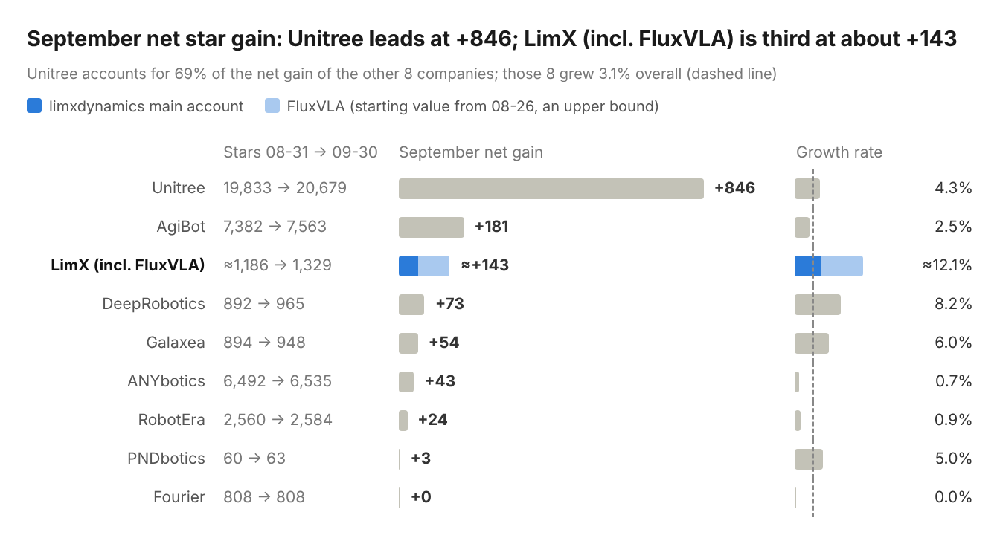
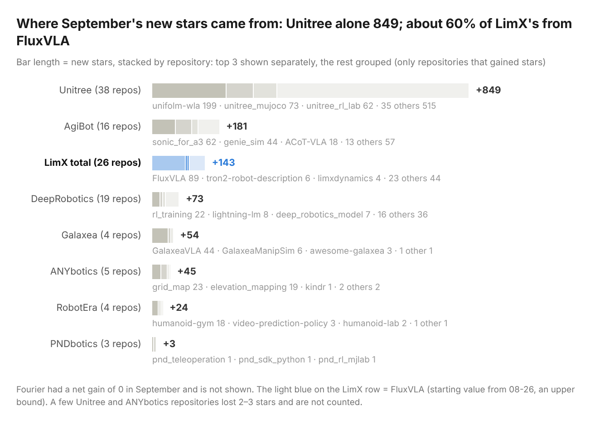

  <a href="README.md">中文</a> | <b>English</b>

# Embodied AI Open-Source Watch · September 2026

> **In one sentence**: open-source attention is shifting from locomotion control to embodied foundation models, and the field is getting more top-heavy. Unitree alone gained 2.2 times as many stars as the other seven companies combined.

This report is written by the LimX team from a daily archive of the public GitHub API. Net star gain is the difference between the 2026-08-31 and 2026-09-30 snapshots; forks, issues and PRs are counted by creation time within September (Beijing time). The full method and the conflict-of-interest disclosure are at the [end](#method-and-disclosure).

## The month at a glance

| Number | What it means |
| --- | --- |
| **+1,224** | Combined net star gain in September of the eight companies other than LimX (their total rose from 38,921 to 40,145, a growth rate of 3.1%) |
| **69%** | Unitree's share of that combined gain |
| **About half** | Share of the gain among the top 14 repositories that came from foundation models, VLA and world models |
| **261 : 5** | Stars of the 2 new repositories launched with a product release vs. the other 9 repositories created this month, combined |
| **3rd place** | LimX (including FluxVLA) gained about +143 stars in September, behind Unitree (846) and AgiBot (181) |

## Trends this month

1. **Open source is shifting to embodied foundation models**: half of the gain on the growth chart came from foundation models, VLA and world models, while SDKs and ROS packages ranked lower.
2. **Humanoid control is moving to "motion data + general frameworks"**: AgiBot, DeepRobotics and LimX all opened motion-imitation or retargeting repositories in September. AgiBot's sonic_for_a3 adapts NVIDIA's general framework SONIC to its own robot and got 62 stars in its first week.
3. **Simulation and RL training repositories are reused the most**: the top 3 repositories by new forks in September are all simulation or RL training. Older repositories such as unitree_mujoco, unitree_rl_lab and genie_sim, each more than six months old and with no new release, still gained 44–73 stars each.
4. **A concentrated top and a split field**: Unitree's +846 is 2.2 times the other seven combined; the second tier (AgiBot, LimX, DeepRobotics, Galaxea) gained 54–181 stars each.
5. **A release does not bring attention by itself**: a new repository needs videos, a technical report or other promotion to win its first users.

[Jump to the trends in detail ↓](#trends-in-detail)

---

## The month in detail

### Who is growing

> Unitree leads with a net gain of 846, followed by AgiBot at 181 and LimX (including FluxVLA) at about 143. RobotEra gained 24 and PNDbotics 3; Fourier's star count did not change in September.

### Which repositories the stars went to

> Of Unitree's 846, 199 came from unifolm-wla, created in September; the other 647 were spread over 54 existing repositories (37 grew and 3 fell slightly). About 80% of Galaxea's gain came from GalaxeaVLA, and about 60% of LimX's from FluxVLA.

### Who opened new repositories

Counted by GitHub creation time (`created_at`), including forked repositories (mirror forks made only to open a PR are excluded):

| Company | Created in September | Notable projects | Stars at end of September |
| --- | --- | --- | --- |
| Unitree | 2 | unifolm-wla (humanoid foundation model, 09-11) | 199 |
| AgiBot | 2 | sonic_for_a3 (humanoid whole-body control, 09-24) | 62 |
| DeepRobotics | 1 | deep-research | 0 |
| LimX | 6 | luna-beyondmimic (motion imitation), luna-description (robot description), tron2-navigation-ros2 (ROS 2 navigation), tron2-navigation-pct-gpl / -fastlio-gpl (navigation dependencies), tron2_manipulation_controller (manipulation control) | 5 |
| Other 5 companies | 0 | — | — |

> Of the 11 repositories created this month, only the 2 that launched with a new product got noticeable attention.

### Community activity (August → September)

| Company | New forks | New issues | New PRs |
| --- | --- | --- | --- |
| Unitree | 250 → 220 | 16 → 26 | 21 → 20 |
| AgiBot | 13 → 33 | 8 → 2 | 8 → 6 |
| LimX (incl. FluxVLA) | 23 → 21 | 3 → 5 | 17 → 27 |
| DeepRobotics | 14 → 18 | 3 → 2 | 4 → 6 |
| Galaxea | 4 → 17 | 9 → 4 | 1 → 1 |
| ANYbotics | 13 → 9 | 1 → 0 | 7 → 2 |
| Fourier | 4 → 2 | 1 → 0 | 0 → 0 |
| RobotEra | 2 → 3 | 0 → 0 | 0 → 0 |
| PNDbotics | 1 → 0 | 0 → 0 | 0 → 0 |

> Unitree's new forks in September were 2.7 times the other seven companies combined (82). Of its 26 new issues, 9 were on the newly released UnifoLM-WLA, most of them asking when the model weights and deployment code will be opened. Fourier, PNDbotics and RobotEra had no new issues or PRs this month.

### Growth chart

| # | Repository | Company | September +stars | Area |
| --- | --- | --- | --- | --- |
| 1 | [unifolm-wla](https://github.com/unitreerobotics/unifolm-wla) 🆕 | Unitree | 199 | Humanoid foundation model |
| 2 | [FluxVLA](https://github.com/FluxVLA/FluxVLA) | LimX | ≈89 | VLA engineering platform |
| 3 | [unitree_mujoco](https://github.com/unitreerobotics/unitree_mujoco) | Unitree | 73 | MuJoCo simulation |
| 4 | [unitree_rl_lab](https://github.com/unitreerobotics/unitree_rl_lab) | Unitree | 62 | RL training |
| 5 | [sonic_for_a3](https://github.com/AgibotTech/sonic_for_a3) 🆕 | AgiBot | 62 | Humanoid whole-body control |
| 6 | [unifolm-vla](https://github.com/unitreerobotics/unifolm-vla) | Unitree | 57 | VLA |
| 7 | [unitree_sdk2](https://github.com/unitreerobotics/unitree_sdk2) | Unitree | 54 | SDK |
| 8 | [unitree_rl_gym](https://github.com/unitreerobotics/unitree_rl_gym) | Unitree | 54 | RL training |
| 9 | [unifolm-world-model-action](https://github.com/unitreerobotics/unifolm-world-model-action) | Unitree | 48 | World model |
| 10 | [xr_teleoperate](https://github.com/unitreerobotics/xr_teleoperate) | Unitree | 45 | XR teleoperation |
| 11 | [unitree_rl_mjlab](https://github.com/unitreerobotics/unitree_rl_mjlab) | Unitree | 44 | RL training |
| 12 | [GalaxeaVLA](https://github.com/OpenGalaxea/GalaxeaVLA) | Galaxea | 44 | VLA |
| 13 | [genie_sim](https://github.com/AgibotTech/genie_sim) | AgiBot | 44 | Simulation |
| 14 | [unitree_ros2](https://github.com/unitreerobotics/unitree_ros2) | Unitree | 35 | ROS 2 |

> 🆕 marks repositories created in September. Five repositories on the chart are foundation models, VLA or world models; together they gained about 437 stars, half of the chart's total.
>
> Releases this month: FluxVLA v0.1.5; Unitree unitree_sdk2_rs v0.2.0 / v0.3.0; AgiBot agillink_omnihand_sdk v1.1.9.

---

## Trends in detail

### 1. Open source is shifting to embodied foundation models

- Of the top 14 repositories on the growth chart, 5 are foundation models, VLA or world models. Together they gained about 437 stars, half of the chart's total.
- Unitree's UnifoLM now has three lines: world model (2025-09), VLA (2026-01) and WLA (2026-09). AgiBot has ACoT-VLA and Genie Envisioner. Of Galaxea's 54 new stars, 44 came from GalaxeaVLA.

### 2. Humanoid control is moving to "motion data + general frameworks"

- At least 3 companies opened motion-imitation, retargeting or whole-body-control repositories in September: AgiBot's sonic_for_a3 (created 09-24), DeepRobotics' mimic / retarget (created in August, first made public in September), and LimX's luna-beyondmimic (created 09-03) and GMR (created in May, first made public in September).
- sonic_for_a3 adapts NVIDIA's SONIC directly to AgiBot's own robot and got 62 stars in its first week.

### 3. Simulation and RL training repositories are reused the most

- The top 3 repositories by new forks in September are all simulation or RL training: unitree_mujoco +24, unitree_rl_mjlab +21, unitree_rl_lab +19. These three and genie_sim are all more than six months old and had no new release in September, yet each still gained 44–73 stars.
- Training frameworks run on two tracks, Isaac Lab and MuJoCo / mjlab. Unitree, Fourier, PNDbotics and LimX each maintain both.

### 4. A concentrated top and a split field

- Unitree's +846 is 69% of the combined gain of the eight companies other than LimX, and 2.2 times the gain of the other seven combined (378). The second tier (AgiBot, LimX, DeepRobotics, Galaxea) gained 54–181 stars each.

### 5. A release does not bring attention by itself

- The companies created 11 repositories in September. Only unifolm-wla and sonic_for_a3, which launched with new products, got noticeable attention (261 stars combined); the other 9 got 5 stars combined.
- In the week after v0.1.5 and the technical report went live (09-14 to 09-21), FluxVLA gained about 4.6 stars a day, more than twice the rate in the last week of September (1.7).

---

## Method and disclosure

**What is counted**

- LimX: the main limxdynamics account (50 public repositories at the end of September, 44 of them non-fork and 6 forks) plus the FluxVLA organisation (FluxVLA, FluxBisim, FluxDAgger). "LimX (incl. FluxVLA)" is the sum of the two.
- The other 8 companies: Unitree (unitreerobotics), AgiBot (AgibotTech), DeepRobotics (DeepRoboticsLab), Galaxea (OpenGalaxea), ANYbotics, RobotEra (roboterax), Fourier (FFTAI) and PNDbotics (pndbotics).

**Sources**

Public data from the GitHub REST API, collected and archived daily. Background information comes from the READMEs of [UnifoLM-WLA](https://github.com/unitreerobotics/unifolm-wla) and [sonic_for_a3](https://github.com/AgibotTech/sonic_for_a3) and from the [FluxVLA technical report](https://arxiv.org/abs/2609.17210).

**Period**

The calendar month of September 2026 (Beijing time). Net star gain is the difference between the 2026-08-31 and 2026-09-30 snapshots, and cross-company comparisons include forked repositories. Forks, issues and PRs are counted when their `created_at` falls in 2026-09; issues exclude PRs. Month-over-month figures use the same method for August.

**Limits**

- Stars and forks measure attention, not actual usage.
- Issue and PR counts do not separate company staff from outside contributors.
- Per-star records (who starred and when) are not available for the other 8 companies, so only repository-level differences can be computed. No daily curve can be built for them, and this report makes no claim about their day-by-day movement.
- The starting star count of the FluxVLA organisation is taken from a record collected on 08-26 (631 stars on the main repository), while daily collection for it only began on 09-24. The "about +143" therefore includes the last days of August and is an upper-bound estimate. Its fork, issue and PR records are complete, including August.
- The trends are drawn from one month of data and will be tested in later reports.

**Disclosure**

This report is written and maintained by the LimX team. For LimX and FluxVLA repositories, per-star records, fork sources and internal activity are collected directly and are more detailed than the data for other companies, for which only GitHub's public aggregate data is used. To keep the comparison fair, cross-company rankings and trend judgements use only public data that is available on the same basis for every company. LimX's own detailed data is used only for case reviews and never by itself to conclude that one company is stronger or weaker. The views are the authors' own; corrections are welcome in an issue.
