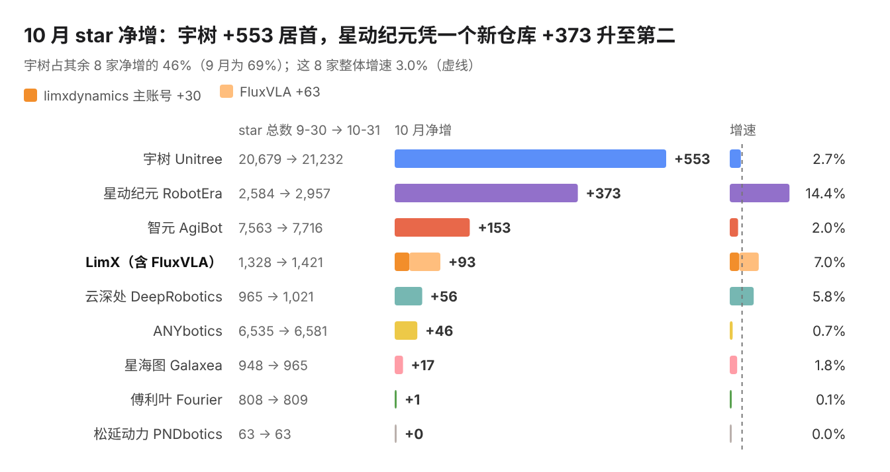
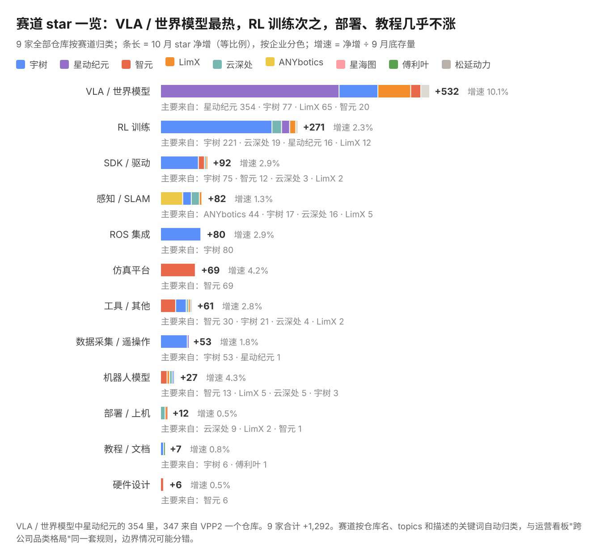
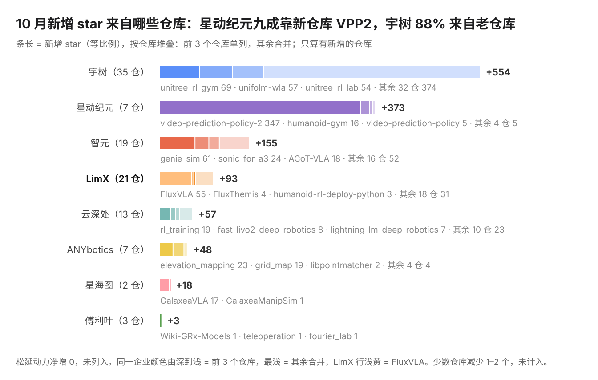
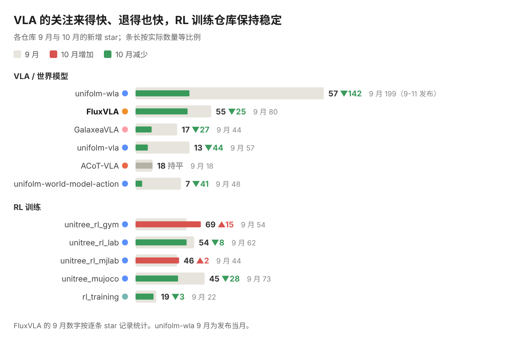
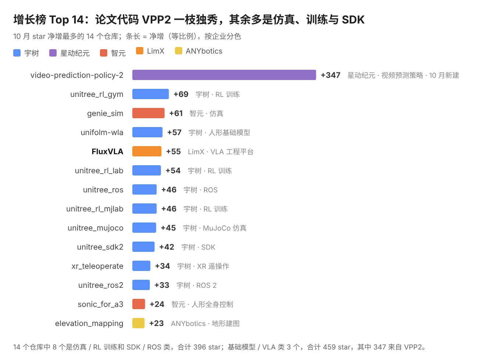
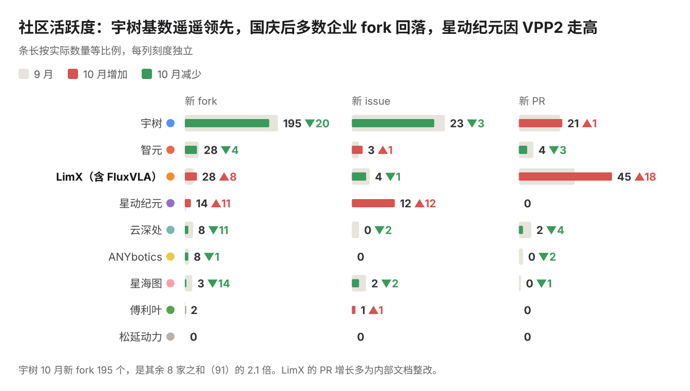

  <b>中文</b> | <a href="README_en.md">English</a>

# 具身智能开源观察 · 2026 年 10 月

本报告由 LimX 团队撰写，数据来自 GitHub 公开 API 每日采集存档，口径与利益披露见[文末](#数据口径与披露)。本期起改版：结论在前，每条趋势附证据图表。

## 本月速览

1. **行业**：9 家合计 +1,292 star，增速 3.1%；新 fork 286（国庆后比 9 月少 10%），新仓库 10 个。
2. **赛道**：VLA / 世界模型最热，+532、增速 10%，但 347 来自 VPP2；RL 训练 +271 次之，八成来自宇树。
3. **企业**：宇树 +553 居首，星动纪元靠一篇论文的代码 +373 升至第二。
4. **使用**：用户一半的 fork 来自仿真、训练和 SDK。
5. **需求**：宇树新机型的适配提问较多。

## 各家 star 一览

> LimX 93 = 主账号 30 + FluxVLA 63。

## 赛道 star 一览

## 本月趋势

### 1. 配套论文的仓库带来了大量关注

[VPP2](https://github.com/roboterax/video-prediction-policy-2) 首日 +85、一周 +221、月底 347；同月其余 9 个新仓库合计 12。

作者团队也直接在 issue 里答疑：当月 11 个提问全部有回复，9 个已关闭。

| 企业 | 10 月新建仓库 | 10 月底 star |
| --- | --- | --- |
| 星动纪元 | video-prediction-policy-2（论文代码） | 347 |
| 智元 | agilink_omniglove_sdk、agilink_omniglove_toolbox、agibot_agentsdk_sample_code、vine-code | 7 |
| 宇树 | unitree_robotskills、D2-Arm | 5 |
| LimX | tron2_visual_grasp、embodied-ai-insights | 0 |
| ANYbotics | Leg-KILO | 0 |

**启示**：与论文配套的代码仓库，容易得到更多关注。

### 2. 老仓库提供稳定增量

57% 的新增 star 来自半年以上的老仓库，宇树高达 88%。unitree_rl_gym 一年多没更新，仍 +69。

**启示**：维护好已有配套，比多开新仓库更划算。

### 3. 用户更关注让机器人跑起来

fork 更接近"在用"：仿真 / 训练和 SDK / ROS 占新 fork 的 49%。

| 类别 | fork 最多的仓库（10 月新 fork） | 合计 fork |
| --- | --- | --- |
| 仿真 / RL 训练 | unitree_rl_mjlab 21、unitree_rl_gym 20、unitree_mujoco 17、unitree_rl_lab 15、genie_sim 9、unitree_sim_isaaclab 8 | 90 |
| 基础模型 / VLA | unifolm-wla 17、FluxVLA 14、video-prediction-policy-2 11、其余 3 个 13 | 55 |
| SDK / ROS | unitree_sdk2_python 16、unitree_sdk2 13、unitree_ros 11、unitree_ros2 8、r1-7a_sdk 3 | 51 |
| 遥操作 | xr_teleoperate 14、teleimager 5 | 19 |

宇树的用户提问也集中在这件事上：21 个提问里，6 个问 H2、R1 等新机型怎么适配。

| 宇树用户提问（21 个） | 数量 |
| --- | --- |
| 新机型适配（H2、R1） | 6 |
| UnifoLM-WLA 复现与部署 | 4 |
| RL 策略低速指令测试 | 3 |
| 模型参数与仿真转换 | 3 |
| 其他（含"示例代码在哪里"） | 5 |

**启示**：优先保证仿真、训练和 SDK 的文档与可用性，新机型发布时配套要同步就绪。

### 4. VLA 的关注来得快、退得也快，RL 训练保持稳定

看各赛道的主力仓库：VLA / 世界模型类从 9 月的 446 个新增 star 降到 10 月的 167 个（-63%），RL 训练类只从 255 降到 233（-9%）。

**启示**：VLA 靠发布和论文冲高，过后很快回落；RL 训练这类配套是持续的关注来源。

## 本月数据

### 增长榜 Top 14

### 社区活跃度（9 月 → 10 月）

### 提问响应

| 企业 | 10 月用户提问 | 有评论 | 已关闭 | 累计未关闭 issue |
| --- | --- | --- | --- | --- |
| 宇树 | 21 | 5 | 0 | 798 |
| 星动纪元 | 11 | 11 | 9 | 33 |
| 智元 | 3 | 1 | 1 | 153 |
| LimX（含 FluxVLA） | 2 | 1 | 2 | 13 |
| ANYbotics | 0 | — | — | 267 |

> 不含第三方账号 PHM-Audit 的 8 个模型核查类 issue。

### 版本发布

- **智元**：灵巧手 SDK agilink_omnihand_sdk 升级到 v1.1.10（10-15）；数据手套 SDK agilink_omniglove_sdk 发布首个版本 v1.0.0（10-30）
- **云深处**：station-openapi-devkit 升级到 v1.1.0（10-20）
- **LimX**：FluxVLA 升级到 v0.2.0（10-30）

## 数据口径与披露

- **对象**：9 家企业的 GitHub 组织；LimX = limxdynamics + FluxVLA。乐聚自 11 月起纳入。
- **周期**：10 月（北京时间）；star 取 09-30 与 10-31 快照之差，fork / issue / PR 按创建时间。
- **细节**：智元仓库更名按同一仓库计；FluxVLA 按逐条记录截取（765 → 828）；用户提问不含 PHM-Audit；9 月环比按当前存档重算，可能与上期差 1–5。
- **局限**：star、fork 不等于实际使用量；issue / PR 未区分内外部。
- **披露**：本报告由 LimX 撰写；跨企业比较只用各家都能获得的公开数据。观点仅代表作者，欢迎通过 issue 指正。
