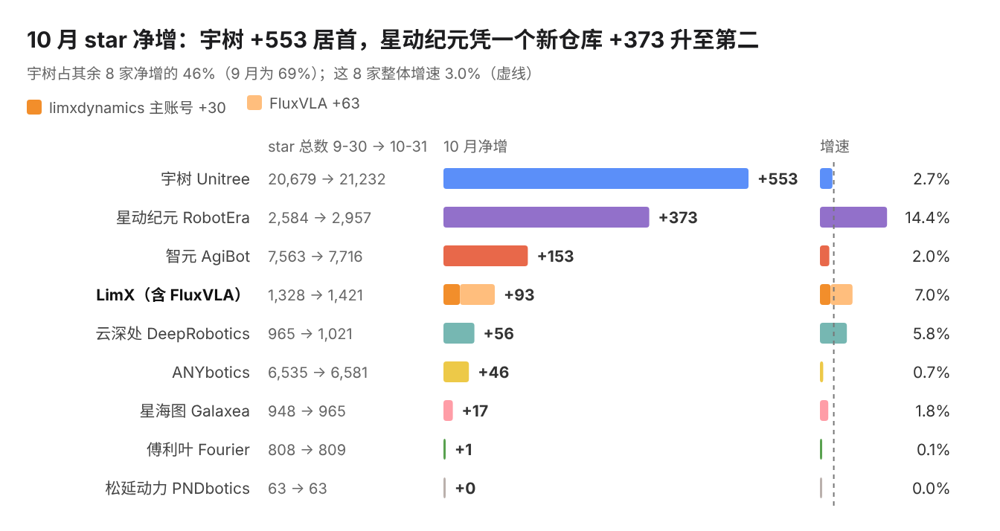
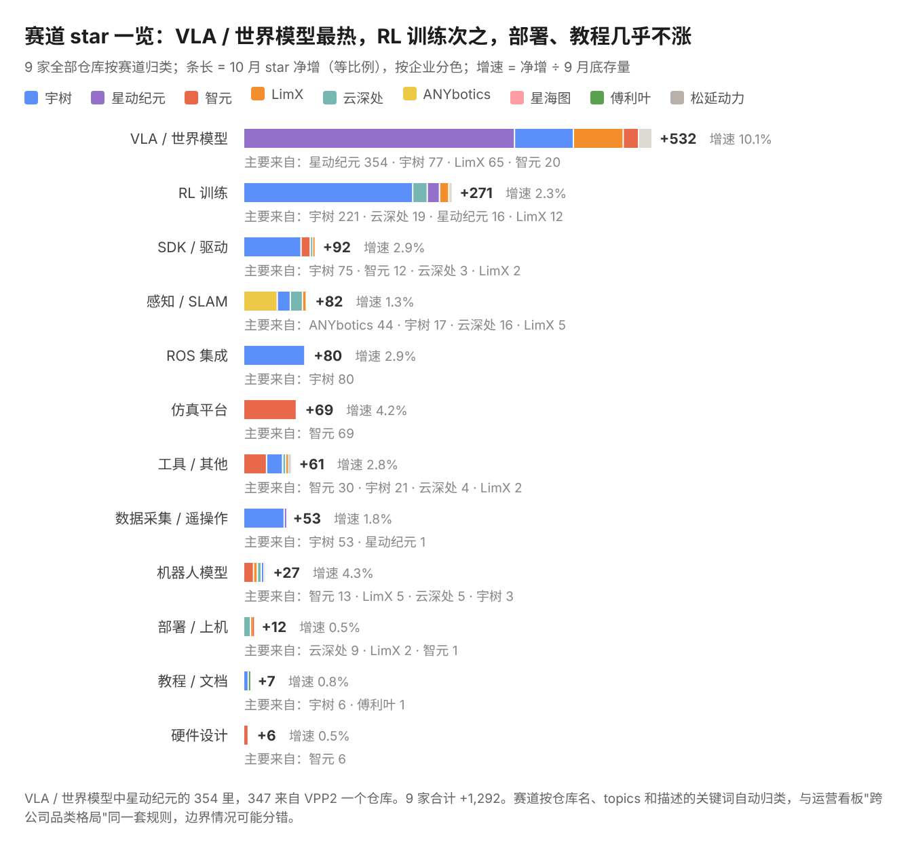
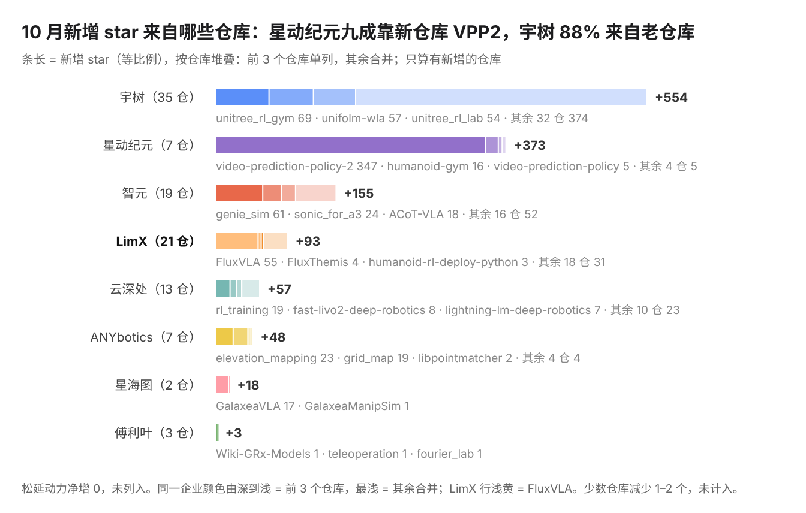
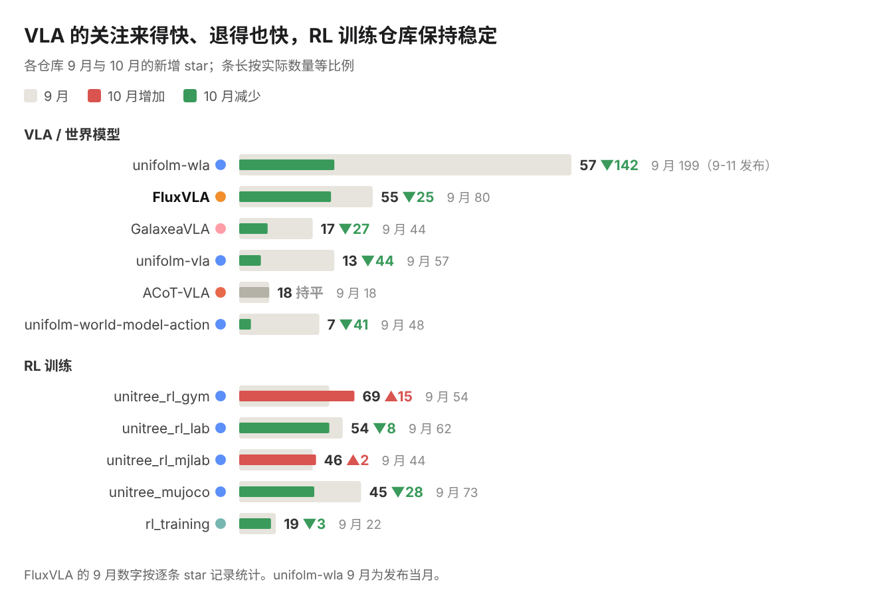
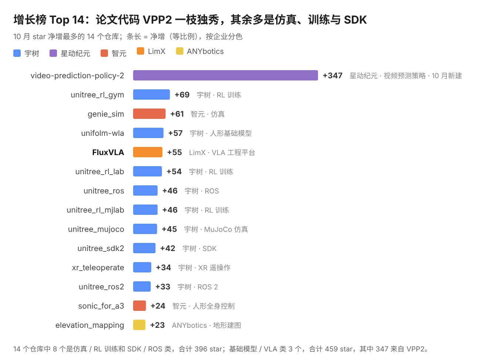
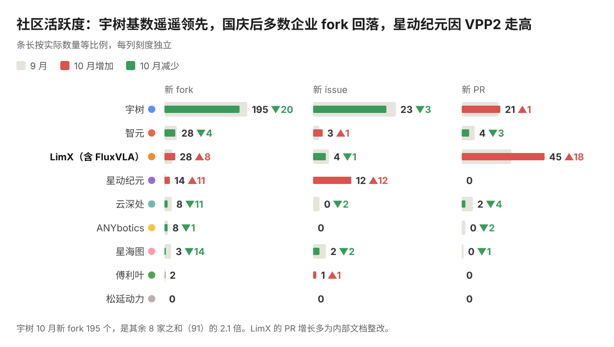

  <a href="README.md">中文</a> | <b>English</b>

# Embodied AI Open-Source Watch · October 2026

This report is written by the LimX team from a daily archive of the public GitHub API. The method and the conflict-of-interest disclosure are at the [end](#method-and-disclosure). New layout from this issue: conclusions first, and each trend comes with its evidence. Chart labels are in Chinese; the figures in each chart are repeated in English below it.

## The month at a glance

1. **Industry**: the 9 companies gained 1,292 stars combined, a growth rate of 3.1%. There were 286 new forks (10% fewer than in September, after the National Day holiday) and 10 new repositories.
2. **Categories**: VLA / world models were the hottest at +532 and a 10% growth rate, but 347 of that came from VPP2. RL training came next at +271, about 80% of it from Unitree.
3. **Companies**: Unitree led with +553. RobotEra rose to second with +373 on the code for a single paper.
4. **Usage**: half of all new forks went to simulation, training and SDK repositories.
5. **Demand**: Unitree received many questions about adapting to its new robot models.

## Stars by company

| Company | Stars 09-30 → 10-31 | Net gain | Growth rate |
| --- | --- | --- | --- |
| Unitree | 20,679 → 21,232 | +553 | 2.7% |
| RobotEra | 2,584 → 2,957 | +373 | 14.4% |
| AgiBot | 7,563 → 7,716 | +153 | 2.0% |
| LimX (incl. FluxVLA) | 1,328 → 1,421 | +93 | 7.0% |
| DeepRobotics | 965 → 1,021 | +56 | 5.8% |
| ANYbotics | 6,535 → 6,581 | +46 | 0.7% |
| Galaxea | 948 → 965 | +17 | 1.8% |
| Fourier | 808 → 809 | +1 | 0.1% |
| PNDbotics | 63 → 63 | +0 | 0.0% |

> LimX 93 = main account 30 + FluxVLA 63. Unitree accounts for 46% of the net gain of the eight companies other than LimX (69% in September); those eight grew 3.0% overall.

## Stars by category

All repositories of the 9 companies, grouped by category. Growth rate = net gain ÷ stars at the end of September.

| Category | Net gain | Growth rate | Mainly from |
| --- | --- | --- | --- |
| VLA / world models | +532 | 10.1% | RobotEra 354, Unitree 77, LimX 65, AgiBot 20 |
| RL training | +271 | 2.3% | Unitree 221, DeepRobotics 19, RobotEra 16, LimX 12 |
| SDK / drivers | +92 | 2.9% | Unitree 75, AgiBot 12, DeepRobotics 3, LimX 2 |
| Perception / SLAM | +82 | 1.3% | ANYbotics 44, Unitree 17, DeepRobotics 16, LimX 5 |
| ROS integration | +80 | 2.9% | Unitree 80 |
| Simulation platforms | +69 | 4.2% | AgiBot 69 |
| Tools / other | +61 | 2.8% | AgiBot 30, Unitree 21, DeepRobotics 4, LimX 2 |
| Data collection / teleoperation | +53 | 1.8% | Unitree 53, RobotEra 1 |
| Robot models | +27 | 4.3% | AgiBot 13, LimX 5, DeepRobotics 5, Unitree 3 |
| Deployment / on-robot | +12 | 0.5% | DeepRobotics 9, LimX 2, AgiBot 1 |
| Tutorials / docs | +7 | 0.8% | Unitree 6, Fourier 1 |
| Hardware design | +6 | 0.5% | AgiBot 6 |

> Of RobotEra's 354 in VLA / world models, 347 came from the single repository VPP2. Categories are assigned automatically from keywords in repository names, topics and descriptions, so borderline cases may be misfiled.

## Trends this month

### 1. Repositories released with a paper drew a lot of attention

[VPP2](https://github.com/roboterax/video-prediction-policy-2) gained 85 stars on its first day, 221 in its first week and 347 by the end of the month. The other 9 repositories created the same month got 12 combined.

The authors also answered questions directly in the issues: all 11 questions asked during the month got a reply, and 9 were closed.

| Company | Repositories created in October | Stars at end of October |
| --- | --- | --- |
| RobotEra | video-prediction-policy-2 (paper code) | 347 |
| AgiBot | agilink_omniglove_sdk, agilink_omniglove_toolbox, agibot_agentsdk_sample_code, vine-code | 7 |
| Unitree | unitree_robotskills, D2-Arm | 5 |
| LimX | tron2_visual_grasp, embodied-ai-insights | 0 |
| ANYbotics | Leg-KILO | 0 |

**Takeaway**: a code repository that accompanies a paper tends to get more attention.

### 2. Older repositories provide steady growth

57% of new stars went to repositories more than six months old; for Unitree the share is 88%. unitree_rl_gym has not been updated for over a year and still gained 69.

Only repositories that gained stars are counted; the top 3 of each company are listed and the rest are grouped.

| Company (repositories with gains) | New stars | Top repositories |
| --- | --- | --- |
| Unitree (35) | +554 | unitree_rl_gym 69, unifolm-wla 57, unitree_rl_lab 54, other 32 repositories 374 |
| RobotEra (7) | +373 | video-prediction-policy-2 347, humanoid-gym 16, video-prediction-policy 5, other 4 repositories 5 |
| AgiBot (19) | +155 | genie_sim 61, sonic_for_a3 24, ACoT-VLA 18, other 16 repositories 52 |
| LimX (21) | +93 | FluxVLA 55, FluxThemis 4, humanoid-rl-deploy-python 3, other 18 repositories 31 |
| DeepRobotics (13) | +57 | rl_training 19, fast-livo2-deep-robotics 8, lightning-lm-deep-robotics 7, other 10 repositories 23 |
| ANYbotics (7) | +48 | elevation_mapping 23, grid_map 19, libpointmatcher 2, other 4 repositories 4 |
| Galaxea (2) | +18 | GalaxeaVLA 17, GalaxeaManipSim 1 |
| Fourier (3) | +3 | Wiki-GRx-Models 1, teleoperation 1, fourier_lab 1 |

> PNDbotics had a net gain of 0 and is not listed. A few repositories lost 1–2 stars and are not counted, which is why some totals here are slightly above the net gains.

**Takeaway**: keeping existing supporting repositories in good shape pays off more than opening new ones.

### 3. Users care most about getting the robot running

Forks are closer to "in use": simulation / training and SDK / ROS account for 49% of new forks.

| Category | Most-forked repositories (new forks in October) | Total forks |
| --- | --- | --- |
| Simulation / RL training | unitree_rl_mjlab 21, unitree_rl_gym 20, unitree_mujoco 17, unitree_rl_lab 15, genie_sim 9, unitree_sim_isaaclab 8 | 90 |
| Foundation models / VLA | unifolm-wla 17, FluxVLA 14, video-prediction-policy-2 11, 3 others 13 | 55 |
| SDK / ROS | unitree_sdk2_python 16, unitree_sdk2 13, unitree_ros 11, unitree_ros2 8, r1-7a_sdk 3 | 51 |
| Teleoperation | xr_teleoperate 14, teleimager 5 | 19 |

Questions from Unitree's users point the same way: of 21 questions, 6 ask how to adapt to new models such as the H2 and R1.

| Questions from Unitree users (21) | Count |
| --- | --- |
| Adapting to new models (H2, R1) | 6 |
| Reproducing and deploying UnifoLM-WLA | 4 |
| Testing RL policies with low-speed commands | 3 |
| Model parameters and simulation conversion | 3 |
| Other (including "where is the example code") | 5 |

**Takeaway**: put the documentation and usability of simulation, training and SDK repositories first, and have the supporting material ready when a new model ships.

### 4. Attention to VLA comes fast and fades fast; RL training stays steady

Looking at the main repositories in each category: new stars for VLA / world-model repositories fell from 446 in September to 167 in October (-63%), while RL training repositories only fell from 255 to 233 (-9%).

| Category | Repository | Company | September | October | Change |
| --- | --- | --- | --- | --- | --- |
| VLA / world models | unifolm-wla | Unitree | 199 | 57 | -142 |
| VLA / world models | FluxVLA | LimX | 80 | 55 | -25 |
| VLA / world models | GalaxeaVLA | Galaxea | 44 | 17 | -27 |
| VLA / world models | unifolm-vla | Unitree | 57 | 13 | -44 |
| VLA / world models | ACoT-VLA | AgiBot | 18 | 18 | 0 |
| VLA / world models | unifolm-world-model-action | Unitree | 48 | 7 | -41 |
| RL training | unitree_rl_gym | Unitree | 54 | 69 | +15 |
| RL training | unitree_rl_lab | Unitree | 62 | 54 | -8 |
| RL training | unitree_rl_mjlab | Unitree | 44 | 46 | +2 |
| RL training | unitree_mujoco | Unitree | 73 | 45 | -28 |
| RL training | rl_training | DeepRobotics | 22 | 19 | -3 |

> FluxVLA's September figure is counted from per-star records. unifolm-wla was released on 09-11, so September was its launch month.

**Takeaway**: VLA spikes on releases and papers and falls back quickly afterwards; supporting repositories such as RL training are a lasting source of attention.

## Data for the month

### Growth chart: top 14

| # | Repository | Company | October +stars | Area |
| --- | --- | --- | --- | --- |
| 1 | video-prediction-policy-2 🆕 | RobotEra | 347 | Video prediction policy |
| 2 | unitree_rl_gym | Unitree | 69 | RL training |
| 3 | genie_sim | AgiBot | 61 | Simulation |
| 4 | unifolm-wla | Unitree | 57 | Humanoid foundation model |
| 5 | FluxVLA | LimX | 55 | VLA engineering platform |
| 6 | unitree_rl_lab | Unitree | 54 | RL training |
| 7 | unitree_ros | Unitree | 46 | ROS |
| 8 | unitree_rl_mjlab | Unitree | 46 | RL training |
| 9 | unitree_mujoco | Unitree | 45 | MuJoCo simulation |
| 10 | unitree_sdk2 | Unitree | 42 | SDK |
| 11 | xr_teleoperate | Unitree | 34 | XR teleoperation |
| 12 | unitree_ros2 | Unitree | 33 | ROS 2 |
| 13 | sonic_for_a3 | AgiBot | 24 | Humanoid whole-body control |
| 14 | elevation_mapping | ANYbotics | 23 | Terrain mapping |

> 🆕 marks a repository created in October. Of the 14, 8 are simulation / RL training or SDK / ROS repositories with 396 stars combined; 3 are foundation-model / VLA repositories with 459 combined, 347 of them from VPP2.

### Community activity (September → October)

Each cell shows the October count, with the change from September in brackets.

| Company | New forks | New issues | New PRs |
| --- | --- | --- | --- |
| Unitree | 195 (-20) | 23 (-3) | 21 (+1) |
| AgiBot | 28 (-4) | 3 (+1) | 4 (-3) |
| LimX (incl. FluxVLA) | 28 (+8) | 4 (-1) | 45 (+18) |
| RobotEra | 14 (+11) | 12 (+12) | 0 |
| DeepRobotics | 8 (-11) | 0 (-2) | 2 (-4) |
| ANYbotics | 8 (-1) | 0 | 0 (-2) |
| Galaxea | 3 (-14) | 2 (-2) | 0 (-1) |
| Fourier | 2 | 1 (+1) | 0 |
| PNDbotics | 0 | 0 | 0 |

> Unitree's 195 new forks in October are 2.1 times the other eight companies combined (91). Most of LimX's PR growth is internal documentation clean-up.

### Response to questions

| Company | User questions in October | With comments | Closed | Open issues in total |
| --- | --- | --- | --- | --- |
| Unitree | 21 | 5 | 0 | 798 |
| RobotEra | 11 | 11 | 9 | 33 |
| AgiBot | 3 | 1 | 1 | 153 |
| LimX (incl. FluxVLA) | 2 | 1 | 2 | 13 |
| ANYbotics | 0 | — | — | 267 |

> Excludes 8 model-audit issues filed by the third-party account PHM-Audit.

### Releases

- **AgiBot**: the dexterous-hand SDK agilink_omnihand_sdk was updated to v1.1.10 (10-15); the data-glove SDK agilink_omniglove_sdk had its first release, v1.0.0 (10-30)
- **DeepRobotics**: station-openapi-devkit was updated to v1.1.0 (10-20)
- **LimX**: FluxVLA was updated to v0.2.0 (10-30)

## Method and disclosure

- **What is counted**: the GitHub organisations of 9 companies; LimX = limxdynamics + FluxVLA. Leju is included from November.
- **Period**: October (Beijing time). Stars are the difference between the 09-30 and 10-31 snapshots; forks, issues and PRs are counted by creation time.
- **Details**: a renamed AgiBot repository is counted as the same repository; FluxVLA is counted from per-star records (765 → 828); user questions exclude PHM-Audit; the September comparison figures are recomputed from the current archive and may differ from the previous issue by 1–5.
- **Limits**: stars and forks do not equal actual usage; issues and PRs do not separate company staff from outside contributors.
- **Disclosure**: this report is written by LimX. Cross-company comparisons use only public data that is available for every company. The views are the authors' own; corrections are welcome in an issue.
