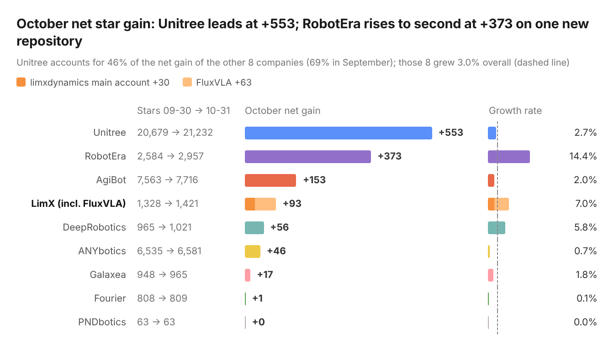
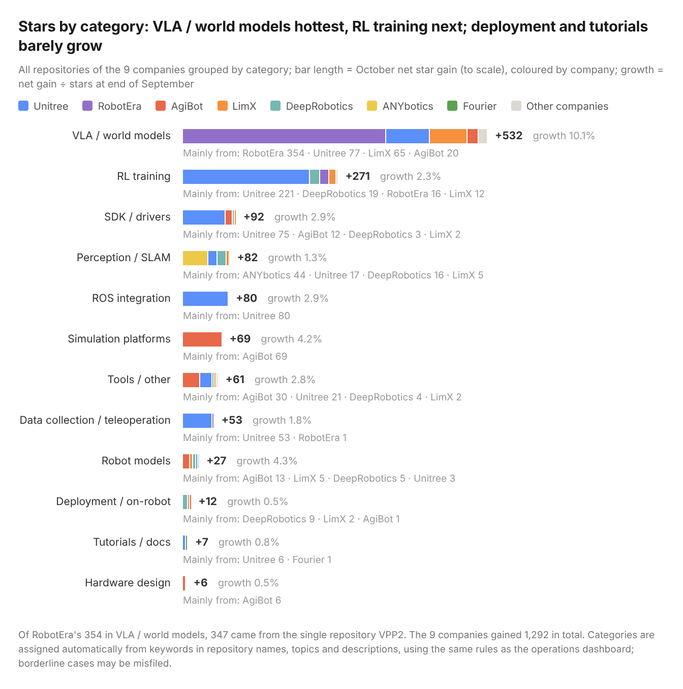
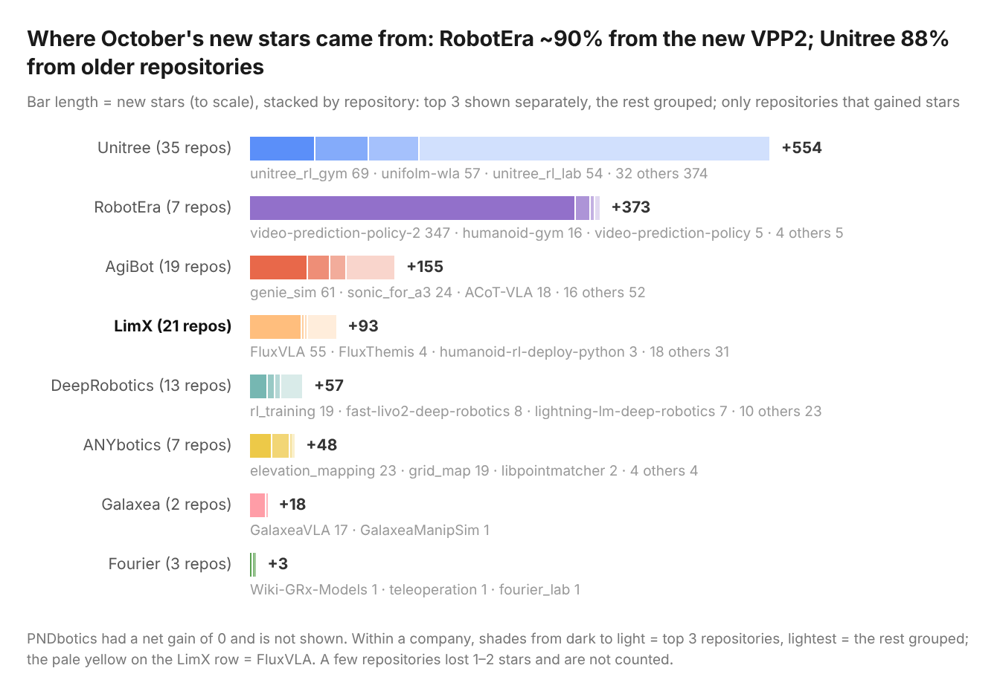
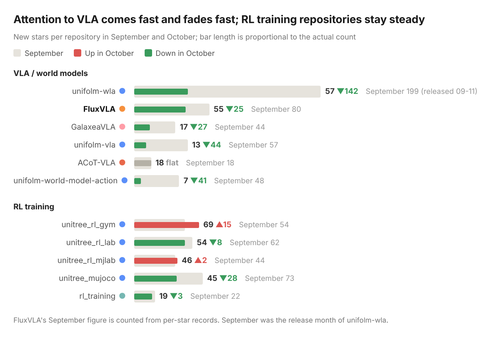
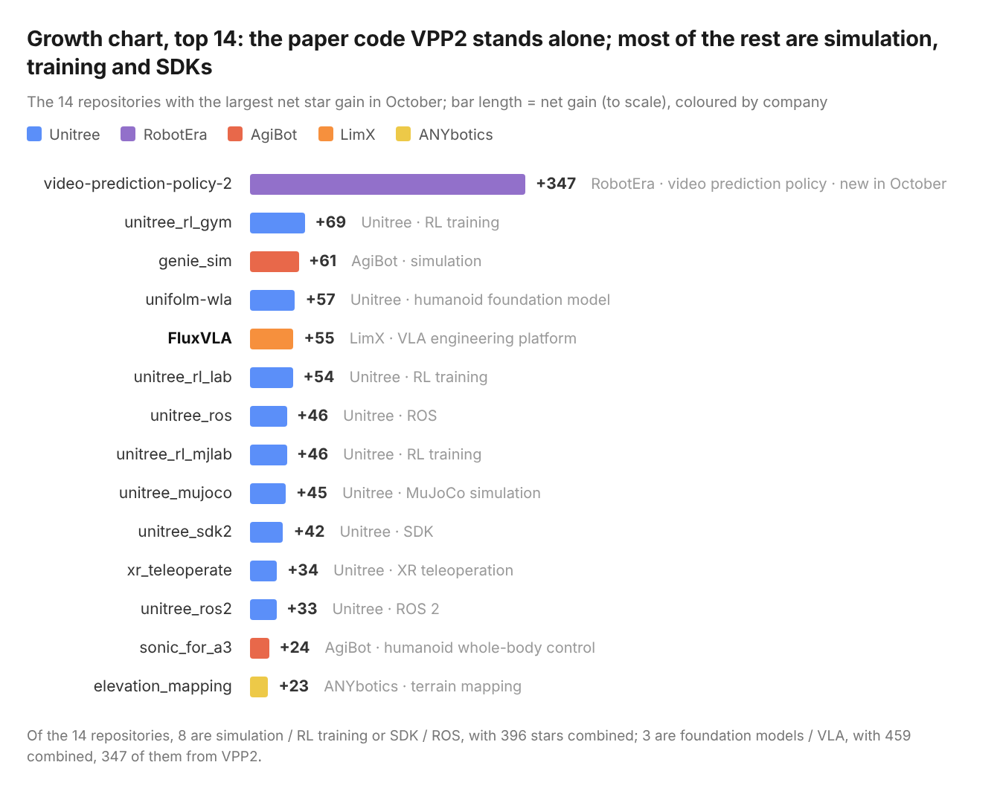
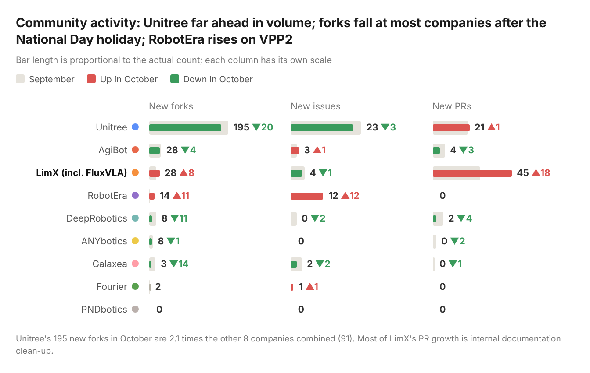

  <a href="README.md">中文</a> | <b>English</b>

# Embodied AI Open-Source Watch · October 2026

This report is written by the LimX team from a daily archive of the public GitHub API. The method and the conflict-of-interest disclosure are at the [end](#method-and-disclosure). New layout from this issue: conclusions first, and each trend comes with its evidence.

## The month at a glance

1. **Industry**: the 9 companies gained 1,292 stars combined, a growth rate of 3.1%. There were 286 new forks (10% fewer than in September, after the National Day holiday) and 10 new repositories.
2. **Categories**: VLA / world models were the hottest at +532 and a 10% growth rate, but 347 of that came from VPP2. RL training came next at +271, about 80% of it from Unitree.
3. **Companies**: Unitree led with +553. RobotEra rose to second with +373 on the code for a single paper.
4. **Usage**: half of all new forks went to simulation, training and SDK repositories.
5. **Demand**: Unitree received many questions about adapting to its new robot models.

## Stars by company

> LimX 93 = main account 30 + FluxVLA 63.

## Stars by category

## Trends this month

### 1. Repositories released with a paper drew a lot of attention

[VPP2](https://github.com/roboterax/video-prediction-policy-2) gained 85 stars on its first day, 221 in its first week and 347 by the end of the month. The other 9 repositories created the same month got 12 combined.

The authors also answered questions directly in the issues: all 11 questions asked during the month got a reply, and 9 were closed.

| Company | Repositories created in October | Stars at end of October |
| --- | --- | --- |
| RobotEra | video-prediction-policy-2 (paper code) | 347 |
| AgiBot | agilink_omniglove_sdk, agilink_omniglove_toolbox, agibot_agentsdk_sample_code, vine-code | 7 |
| Unitree | unitree_robotskills, D2-Arm | 5 |
| LimX | tron2_visual_grasp, embodied-ai-insights | 0 |
| ANYbotics | Leg-KILO | 0 |

**Takeaway**: a code repository that accompanies a paper tends to get more attention.

### 2. Older repositories provide steady growth

57% of new stars went to repositories more than six months old; for Unitree the share is 88%. unitree_rl_gym has not been updated for over a year and still gained 69.

**Takeaway**: keeping existing supporting repositories in good shape pays off more than opening new ones.

### 3. Users care most about getting the robot running

Forks are closer to "in use": simulation / training and SDK / ROS account for 49% of new forks.

| Category | Most-forked repositories (new forks in October) | Total forks |
| --- | --- | --- |
| Simulation / RL training | unitree_rl_mjlab 21, unitree_rl_gym 20, unitree_mujoco 17, unitree_rl_lab 15, genie_sim 9, unitree_sim_isaaclab 8 | 90 |
| Foundation models / VLA | unifolm-wla 17, FluxVLA 14, video-prediction-policy-2 11, 3 others 13 | 55 |
| SDK / ROS | unitree_sdk2_python 16, unitree_sdk2 13, unitree_ros 11, unitree_ros2 8, r1-7a_sdk 3 | 51 |
| Teleoperation | xr_teleoperate 14, teleimager 5 | 19 |

Questions from Unitree's users point the same way: of 21 questions, 6 ask how to adapt to new models such as the H2 and R1.

| Questions from Unitree users (21) | Count |
| --- | --- |
| Adapting to new models (H2, R1) | 6 |
| Reproducing and deploying UnifoLM-WLA | 4 |
| Testing RL policies with low-speed commands | 3 |
| Model parameters and simulation conversion | 3 |
| Other (including "where is the example code") | 5 |

**Takeaway**: put the documentation and usability of simulation, training and SDK repositories first, and have the supporting material ready when a new model ships.

### 4. Attention to VLA comes fast and fades fast; RL training stays steady

Looking at the main repositories in each category: new stars for VLA / world-model repositories fell from 446 in September to 167 in October (-63%), while RL training repositories only fell from 255 to 233 (-9%).

**Takeaway**: VLA spikes on releases and papers and falls back quickly afterwards; supporting repositories such as RL training are a lasting source of attention.

## Data for the month

### Growth chart: top 14

### Community activity (September → October)

### Response to questions

| Company | User questions in October | With comments | Closed | Open issues in total |
| --- | --- | --- | --- | --- |
| Unitree | 21 | 5 | 0 | 798 |
| RobotEra | 11 | 11 | 9 | 33 |
| AgiBot | 3 | 1 | 1 | 153 |
| LimX (incl. FluxVLA) | 2 | 1 | 2 | 13 |
| ANYbotics | 0 | — | — | 267 |

> Excludes 8 model-audit issues filed by the third-party account PHM-Audit.

### Releases

- **AgiBot**: the dexterous-hand SDK agilink_omnihand_sdk was updated to v1.1.10 (10-15); the data-glove SDK agilink_omniglove_sdk had its first release, v1.0.0 (10-30)
- **DeepRobotics**: station-openapi-devkit was updated to v1.1.0 (10-20)
- **LimX**: FluxVLA was updated to v0.2.0 (10-30)

## Method and disclosure

- **What is counted**: the GitHub organisations of 9 companies; LimX = limxdynamics + FluxVLA. Leju is included from November.
- **Period**: October (Beijing time). Stars are the difference between the 09-30 and 10-31 snapshots; forks, issues and PRs are counted by creation time.
- **Details**: a renamed AgiBot repository is counted as the same repository; FluxVLA is counted from per-star records (765 → 828); user questions exclude PHM-Audit; the September comparison figures are recomputed from the current archive and may differ from the previous issue by 1–5.
- **Limits**: stars and forks do not equal actual usage; issues and PRs do not separate company staff from outside contributors.
- **Disclosure**: this report is written by LimX. Cross-company comparisons use only public data that is available for every company. The views are the authors' own; corrections are welcome in an issue.
